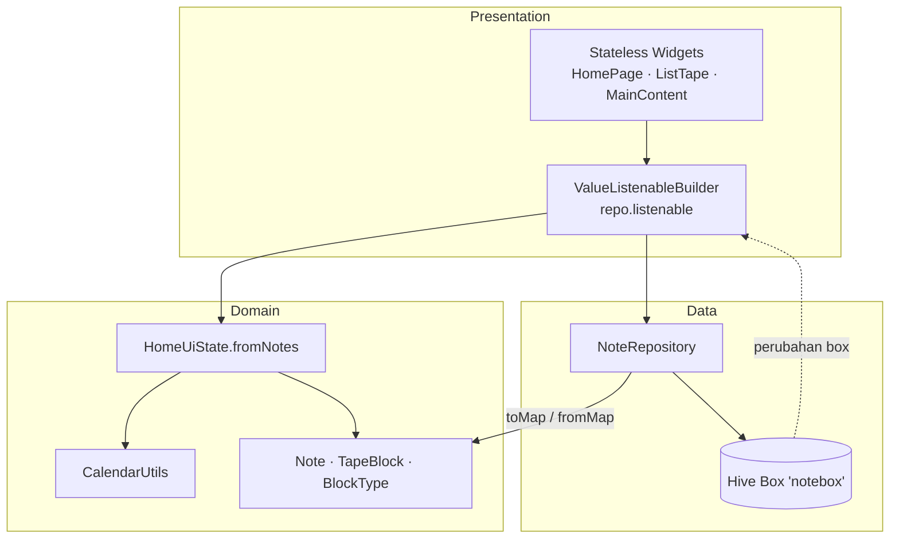

# Tapes

Local-first, hierarchical block-based journaling app. Catat satu hal yang kamu selesaikan setiap hari; semua data tersimpan di perangkat, tanpa backend dan tanpa akun.

| | |
|---|---|
| Platform | Android, iOS, Web, Desktop (Flutter) |
| Storage | Hive — NoSQL key-value, manual map serialization |
| State / DI | Provider + `ValueListenableBuilder` |
| Serialization | `toMap()` / `fromMap()` tanpa code generation |

## Tech Stack

- **Flutter SDK** — UI lintas platform dengan satu basis kode.
- **Dart 3** — model immutable (`const` constructor), pattern matching, class modifiers.
- **Hive** — penyimpanan lokal key-value murni Dart, tanpa SQL dan tanpa native setup.
- **Provider** — dependency injection `NoteRepository` ke widget tree.
- **intl** — format tanggal/bulan (locale `id` diinisialisasi di `main()`).

## Architectural Overview



Prinsip pemisahan:

- **Rendering** — widget presentasional (`ProgressRing`, `WeekCard`, `CalendarGrid`) hanya menerima data jadi lewat constructor `const`; tidak ada akses repository atau Hive di dalamnya.
- **Data transformation** — `NoteRepository` mengubah `Map` Hive menjadi `Note`/`TapeBlock` (dan sebaliknya). Widget tidak pernah memanggil `fromMap` sendiri.
- **UI state** — `HomeUiState.fromNotes()` mengubah daftar `Note` menjadi field siap-render (`progress`, `weekDates`, `monthDates`, label tanggal). `HomePage` cukup memanggil satu baris dan mendistribusikan hasilnya.
- **Reaktivitas** — perubahan box Hive dipancarkan lewat `repo.listenable`, sehingga UI ter-render ulang tanpa `setState` manual.

## Engineering Trade-Offs

### Hive dibanding SQLite

`TapeBlock` adalah pohon rekursif (`children: List<TapeBlock>`). Dengan Hive, satu catatan cukup disimpan sebagai map bersarang (`blocks` → `children` → …) dan dibaca kembali dengan `fromMap` defensif. Di SQLite, struktur ini menuntut tabel relasi + query join/rekursif dan pemetaan ORM, padahal kebutuhan aplikasi hanya key-value per catatan. Hive memberi tulis/baca lokal cepat, reactive listenable bawaan, dan zero-native setup. Konsekuensinya: tidak ada query relasional/agregasi SQL — untuk jurnal personal, itu tidak dibutuhkan.

### Manual map serialization, bukan HiveAdapter

Model tidak memakai `@HiveType`/`@HiveField`/`HiveObject`. Serialisasi manual `toMap()`/`fromMap()` menghilangkan `build_runner` + `hive_generator`, membuat build instan, dan memungkinkan skema defensif: field hilang/null memakai default aman, elemen blok tak valid difilter dengan `whereType<TapeBlock>()`, dan catatan lama tanpa `blocks` dibungkus menjadi satu blok teks.

### Isolasi CalendarUtils untuk determinisme

Seluruh kalkulasi tanggal (progress bulanan, minggu berjalan, grid bulan) dipindah ke `CalendarUtils` sebagai fungsi murni. `calculateProgress` dan `getWeekDates` menerima parameter `now` opsional sehingga unit test tidak bergantung pada jam sistem. `HomeUiState.fromNotes` menerima `clock` untuk alasan yang sama. Tanpa isolasi ini, test hanya bisa memakai `DateTime.now()` dan hasilnya flaky di pergantian hari/bulan.

## Testing & Code Quality

```bash
flutter test
```

| Berkas | Cakupan |
|---|---|
| `test/models/note_test.dart` | Round-trip `toMap`/`fromMap`, parsing defensif (map kosong, `createdAt` rusak, `blocks` null/tipe invalid), presisi tanggal ISO-8601 |
| `test/models/home_ui_state_test.dart` | Mapping deterministik `HomeUiState.fromNotes` (label, progress, week/month dates) dengan `clock` tetap |
| `test/utils/calendar_utils_test.dart` | Strip komponen waktu, progress bulan berjalan/lampau, tahun kabisat, minggu 7 hari mulai Minggu, grid kelipatan 7 |
| `test/presentation/content_page_test.dart` | Widget test form: render input + tombol, alur ketik → simpan via `FakeNoteRepository`, catatan kosong ditolak |
| `test/widget_test.dart` | Smoke test `InderPage`: header home dan navigasi 3 tab |

`analysis_options.yaml` memakai strict mode produksi:

- `strict-casts`, `strict-inference`, `strict-raw-types`
- `missing_required_param` / `missing_return` sebagai error
- lint tambahan: `always_declare_return_types`, `avoid_dynamic_calls`, `unawaited_futures`, `prefer_final_locals`, `prefer_const_constructors`, `prefer_const_literals_to_create_immutables`, `cancel_subscriptions`, `close_sinks`, `avoid_print`

Baseline saat ini: `flutter analyze` → 0 issues.

## Notion Sync Engine Architecture (Roadmap)

Rencana sinkronisasi opsional ke Notion, tetap dengan Hive sebagai sumber kebenaran lokal.

### Mapping TapeBlock → Notion blocks

| `BlockType` | Notion block | Payload |
|---|---|---|
| `text` | `paragraph` | `paragraph.rich_text[0].text.content = block.text` |
| `todo` | `to_do` | `to_do.rich_text[0].text.content = block.text`, `to_do.checked = block.isChecked` |
| `toggle` | `toggle` | `toggle.rich_text[0].text.content = block.text`, `toggle.children = children` (rekursif) |

Anak blok dipetakan rekursif ke `children` Notion; kedalaman mengikuti struktur `TapeBlock.children`. Setiap blok memakai `block.id` lokal sebagai kunci idempotensi, dengan tabel pemetaan `local block id → Notion block id` agar update tidak menduplikasi blok.

### Offline sync queue

- Setiap operasi tulis (`upsert`/`delete`) dicatat ke Hive box `sync_queue` sebagai entri append-only: `op`, `noteId`, `blockId`, `payload`, `attempts`, `nextRetryAt`, `createdAt`.
- Flush dipicu oleh listener konektivitas dan saat aplikasi dibuka; UI tidak pernah menunggu jaringan karena Hive tetap sumber data lokal.
- Retry memakai exponential backoff; respons `429` menghormati header `Retry-After`.
- Operasi idempoten: `upsert` aman diulang, `delete` memakai tombstone sampai server mengonfirmasi.
- Konflik diselesaikan last-write-wins berdasarkan `updatedAt` catatan; antrean bertahan setelah restart karena tersimpan di Hive, bukan memori.

### Network resilience

- Kegagalan jaringan tidak menghapus antrean; entri hanya dihapus setelah sukses.
- Request dibatasi (batching per catatan) agar tidak menabrak rate limit Notion.
- Error permanen (payload invalid) dipindah ke status `failed` dan dilaporkan, bukan di-retry tanpa henti.
- Semua state sinkronisasi bersifat aditif terhadap skema `notebox`; data lokal tetap kompatibel jika sinkronisasi dimatikan.

## Panduan Menjalankan

Prasyarat: Flutter 3.38+ (Dart 3.10+).

```bash
git clone git@github.com:rewindn/tapes.git
cd tapes
flutter pub get
flutter test
flutter run
```

Tidak ada langkah `build_runner`: proyek memakai manual map serialization sehingga tidak ada file generated yang perlu dibangun ulang sebelum run.
