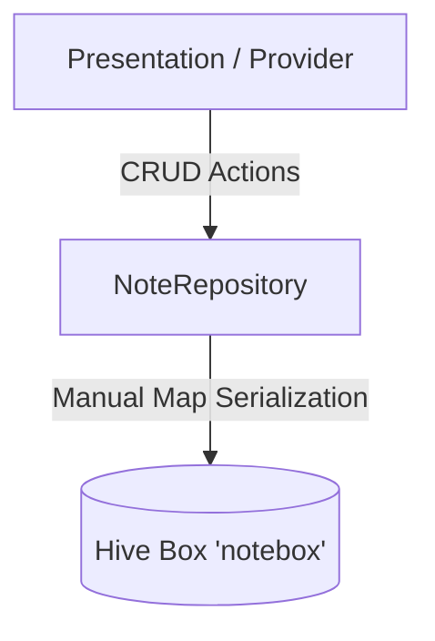

# Tapes

Aplikasi jurnal harian **offline-first** untuk Flutter. Catat satu masalah yang kamu selesaikan setiap hari lewat UI minimalis. Semua data tersimpan lokal: tanpa backend, tanpa akun, tanpa koneksi.

| | |
|---|---|
| Platform | Android, iOS, Web, Desktop (Flutter) |
| Storage | Hive — local NoSQL key-value |
| Serialization | Manual Map (`toMap` / `fromMap`) |
| Reactive UI | `Box.listenable()` via `ValueListenable` |

## Ringkasan Proyek

Tapes adalah aplikasi jurnal/catatan harian dengan pendekatan offline-first: seluruh operasi baca/tulis langsung ke penyimpanan lokal sehingga aplikasi tetap berfungsi tanpa jaringan. UI dibuat minimalis — kalender progres bulanan, form catatan, dan daftar catatan — dengan fokus pada satu kebiasaan: mencatat satu hal yang diselesaikan tiap hari.

## Arsitektur Data



Alur:

1. Widget meminta data ke `NoteRepository`.
2. Repository membaca/menulis ke Hive box `notebox`.
3. Perubahan dipancarkan lewat `listenable()` sehingga UI ikut ter-render ulang tanpa `setState` manual.

## Engineering Decisions & Trade-offs

### Hive sebagai penyimpanan lokal

**Keputusan:** memakai Hive (NoSQL key-value) alih-alih SQLite/Drift.

- **Kecepatan** — baca/tulis lokal tanpa query planner dan tanpa overhead SQL.
- **Zero-native setup** — pure Dart, tanpa NDK/CocoaPods atau platform channel tambahan.
- **Offline-first by default** — data di device, tidak butuh server.
- **Reactive gratis** — `Box.listenable()` memberi notifikasi perubahan siap pakai untuk UI.

**Trade-off:** tidak ada query relasional/agregasi SQL; untuk kebutuhan jurnal skala personal, key-value sudah cukup.

### Manual Map Serialization vs HiveType/HiveAdapter

**Keputusan:** serialisasi manual lewat `toMap()` / `fromMap()` dan menyimpan `Map<String, dynamic>` ke Hive, bukan adapter hasil code generation (`@HiveType`, `@HiveField`, `HiveObject`).

- **Menghilangkan ketergantungan `build_runner` + `hive_generator`** — tidak ada langkah codegen sebelum build/run.
- **Build time instan** — tidak ada file `.g.dart` yang harus diregenerasi setiap model berubah.
- **Skema defensif** — `fromMap` memakai `whereType<TapeBlock>()`, fallback konten lama menjadi satu `TapeBlock`, dan toleran terhadap data Hive yang tidak lengkap sehingga mencegah `TypeError` runtime.
- **Migrasi mudah** — field baru cukup ditangani di `fromMap`/`toMap` tanpa regenerasi adapter.
- **Debuggable** — isi box bisa dibaca langsung sebagai map biasa.

**Trade-off:** keamanan tipe tidak dijamin generator; nama key dan tipe field dijaga manual, dan data lama wajib tetap kompatibel di `fromMap`.

## Struktur Folder Inti

```
lib/
├── models/
│   └── note.dart            # Note, TapeBlock, BlockType + toMap/fromMap
├── repositories/
│   └── note_repository.dart # Operasi Hive box "notebox"
└── presentation/
    ├── pages/
    │   ├── home.dart        # Kalender + progress
    │   ├── content.dart     # Form catatan
    │   └── listtape.dart    # Daftar catatan
    └── widgets/
        └── listcard.dart    # Card catatan
```

## Cara Menjalankan

Prasyarat: Flutter 3.38+ / Dart 3.10+.

```bash
flutter pub get
flutter run
```

Tidak ada langkah `build_runner`. Proyek memakai Manual Map Serialization, jadi tidak ada file generated yang perlu dibangun ulang.

Verifikasi opsional:

```bash
flutter analyze
flutter test
```

## Demo & Screenshots

| Aset | Deskripsi | Link |
|------|-----------|------|
| Demo GIF | Alur: buat catatan → kalender terisi → daftar catatan | `docs/demo.gif` *(placeholder)* |
| Screenshot: Home | Kalender bulanan + progress | `docs/home.png` *(placeholder)* |
| Screenshot: Add Note | Form input catatan | `docs/add-note.png` *(placeholder)* |
| Screenshot: List | Daftar catatan | `docs/list.png` *(placeholder)* |
